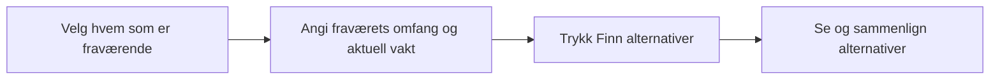

# Første flytskisse – fravær til alternativer

Arbeidsskisse fra Codex 31.10.2026, basert på Odins UX-innspill og valg av
egen handling «Finn alternativer». Dette viser rekkefølge, ikke et vedtatt
skjermoppsett eller visuelt uttrykk.

## Grunnlag

- Odin ser for seg personvalg først og et utvalg alternativer deretter.
- Odin valgte uttrykkelig at lederen trykker «Finn alternativer» etter
  at fraværet og aktuell vakt er valgt. Automatisk søk er ikke valgt.
- Odin valgte deretter at fraværsregistreringen i egenmeldingsscenarioet
  spør om antall dager, med 1 dag som standardverdi. Dette er en
  standardverdi i skjemaet, ikke en lovregel eller en bekreftet prognose.
- Odin presiserte at antallet gjelder arbeidsdager/vakter i planen, med
  standardverdi 1. Fridager telles ikke som berørte arbeidsdager/vakter.
  Dette beskriver skjemaets enhet, ikke kalenderdaggrensene i egenmeldingsordningen.
- Kildene avgrenser hvert søk til ett målskift. Et nytt fravær bruker
  gjeldende grunnlag; valg eller simulert aksept innfører ingen vaktendring.
  Se [kravuttrekket](source-requirements.md) og [scenariouttrekket](source-scenarios.md).

## Ikke avklart i denne skissen

- Hvordan aktuell vakt angis etter personvalg, blant annet når personen har flere vakter.
- Hvordan startvakten velges, og hvordan antallet kobles til berørte
  vakter. Automatisk flervaktregistrering eller endring av søkets ene
  målskift er ikke avklart gjennom valget av enhet og standardverdi.
- Fordeling av informasjon mellom alternativoversikt og detaljer.
- Skjermdeling, visuell stil og konkret skiftlederkontekst.

Disse punktene avklares i SCRUM-47 før den detaljerte UX-flyten ferdigstilles.
Dagfeltet er et nytt UX-valg fra Odin; det avgjør ikke de åpne punktene eller
utvider alene det avtalte søkeomfanget.

## Research som grunnlag for neste avklaring

Odin foreslo egenmelding som mulig standardutgangspunkt og ba om kildesjekk.
[Undersøkelsen](../../../research/domain-egenmelding-varsling-og-fravarsperiode-2026-10-31/research.md)
skiller varsling, dokumentasjonsordning og faktisk fraværsperiode. Et generelt
telefonkrav før vaktstart er ikke verifisert, og egenmeldingsrammen gir
ingen automatisk kjent varighet. Undersøkelsen fastsatte ingen standardverdi.
Odin valgte senere standardverdi 1, der enheten er arbeidsdager/vakter i
planen, slik avsnittet «Grunnlag» beskriver.
Et nytt årsaksfelt eller automatisk valg av flere vakter er fortsatt ikke valgt.
