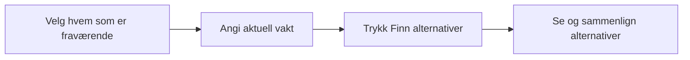

# Første flytskisse – fravær til alternativer

Arbeidsskisse fra Codex 31.10.2026, basert på Odins UX-innspill og valg av
egen handling «Finn alternativer». Dette viser rekkefølge, ikke et vedtatt
skjermoppsett eller visuelt uttrykk.

## Grunnlag

- Odin ser for seg personvalg først og et utvalg alternativer deretter.
- Odin valgte uttrykkelig at lederen trykker «Finn alternativer» etter
  at fraværet og aktuell vakt er valgt. Automatisk søk er ikke valgt.
- Kildene avgrenser hvert søk til ett målskift. Et nytt fravær bruker
  gjeldende grunnlag; valg eller simulert aksept innfører ingen vaktendring.
  Se [kravuttrekket](source-requirements.md) og [scenariouttrekket](source-scenarios.md).

## Ikke avklart i denne skissen

- Hvordan aktuell vakt angis etter personvalg, blant annet når personen har flere vakter.
- Fordeling av informasjon mellom alternativoversikt og detaljer.
- Skjermdeling, visuell stil og konkret skiftlederkontekst.

Disse punktene er UX-avklaringer i SCRUM-47. De er ikke nye produktkrav eller
grunnlag for å endre produktbriefen nå.
