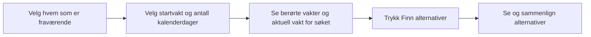

# Første flytskisse – fravær til alternativer

Arbeidsskisse fra Codex 31.10.2026, basert på Odins UX-innspill og valg av
egen handling «Finn alternativer». Dette viser rekkefølge, ikke et vedtatt
skjermoppsett eller visuelt uttrykk.



## Grunnlag

- Odin ser for seg personvalg først og et utvalg alternativer deretter.
- Odin valgte uttrykkelig at lederen trykker «Finn alternativer» etter
  at fraværet og aktuell vakt er valgt. Automatisk søk er ikke valgt.
- Odin valgte deretter at fraværsregistreringen i egenmeldingsscenarioet
  spør om antall dager, med 1 dag som standardverdi. Dette er en
  standardverdi i skjemaet, ikke en lovregel eller en bekreftet prognose.
- Etter kildeoppfølgingen valgte Odin kalenderdager og separat visning av
  berørte vakter, fortsatt med standardverdi 1. Dette erstatter hans tidligere
  valg om å telle arbeidsdager/vakter i planen. Fridager inngår i perioden,
  men gir i seg selv ingen vakter som trenger dekning.
- Odin valgte at neste planlagte vakt foreslås som startvakt, med mulighet
  til å velge en annen. I demoen brukes datasettets vurderingstidspunkt
  som grunnlag, etter eksisterende PRD FR-10, ikke maskinens klokke.
- Kildene avgrenser hvert søk til ett målskift. Et nytt fravær bruker
  gjeldende grunnlag; valg eller simulert aksept innfører ingen vaktendring.
  Se [kravuttrekket](source-requirements.md) og [scenariouttrekket](source-scenarios.md).

## Ikke avklart i denne skissen

- Hvordan nattvakter som krysser en periodegrense skal inngå, og hvordan
  en eventuell ukjent varighet håndteres. Automatisk registrering av flere
  fravær eller samlet søk for flere målskift er ikke avklart gjennom valget
  om å vise berørte vakter.
- Fordeling av informasjon mellom alternativoversikt og detaljer.
- Skjermdeling, visuell stil og konkret skiftlederkontekst.

Disse punktene avklares i SCRUM-47 før den detaljerte UX-flyten ferdigstilles.
Dagfeltet er et nytt UX-valg fra Odin; det avgjør ikke de åpne punktene eller
utvider alene det avtalte søkeomfanget.

## Skjemaskisse til gjennomgang

Felt og standardverdier nedenfor gjengir valgene over. Feltrekkefølge,
etiketter og oppdeling er Codex sin arbeidsskisse til gjennomgang,
ikke et ferdig vedtatt skjermoppsett. Ingen ny fraværsårsak er valgt.

```text
FRAVÆR

Fraværende ansatt       [ Velg ansatt                 ]
Startvakt              [ Neste planlagte vakt       v ]
Antall kalenderdager   [ 1                          ]
Periode                [ Fra dato – til dato         ]

Berørte vakter         [ Vakter i valgt periode       ]
Aktuell vakt for søket [ Valgt startvakt             v ]

                       [ Finn alternativer           ]
```

Startvakten kan endres. Periodefeltet er en foreslått visning av datospennet,
ikke et ekstra datofelt som Odin har valgt. Codex sin arbeidsskisse lar
startvaktens dato være første kalenderdag, inkluderer den i antallet og
viser startvakten som aktuell vakt for søket. Endelig datobetjening og
bytte mellom berørte vakter avklares videre.

Konstruert eksempel fra Codex: Med start fredag og 3 kalenderdager vises
fredag–søndag. Hvis planen bare har en fredagsvakt i perioden, vises den;
en mandagsvakt trekkes ikke inn som «neste vakt» for å fylle antallet 3.
Eksemplet gjelder vakter innenfor én dato; nattvaktgrensene er fortsatt åpne.

## Research som grunnlag for neste avklaring

Odin foreslo egenmelding som mulig standardutgangspunkt og ba om kildesjekk.
[Undersøkelsen](../../../research/domain-egenmelding-varsling-og-fravarsperiode-2026-10-31/research.md)
skiller varsling, dokumentasjonsordning og faktisk fraværsperiode. Et generelt
telefonkrav før vaktstart er ikke verifisert, og egenmeldingsrammen gir
ingen automatisk kjent varighet. Undersøkelsen fastsatte ingen standardverdi.
Odin valgte senere standardverdi 1 og først arbeidsdager/vakter som enhet.
Etter oppfølgingen valgte han kalenderdager med separat visning av berørte
vakter, slik avsnittet «Grunnlag» beskriver.
Et nytt årsaksfelt eller automatisk valg av flere vakter er fortsatt ikke valgt.

Oppfølgingen om vanlig registrering fant to leverandøreksempler med
perioderegistrering: fra–til-dato hos DNB og løpende fravær med startdato
hos PowerOffice. Egenmeldingens dokumentasjonsramme bruker kalenderdager.
Se rapportens oppfølging og kildehenvisninger. Codex foreslo kalenderperiode
med separat oversikt over berørte vakter. Odin valgte deretter denne enheten
uttrykkelig i UX-avklaringen 31.10.2026. Standardverdien 1 er et UX-valg,
ikke en kildebestemt varighet.
